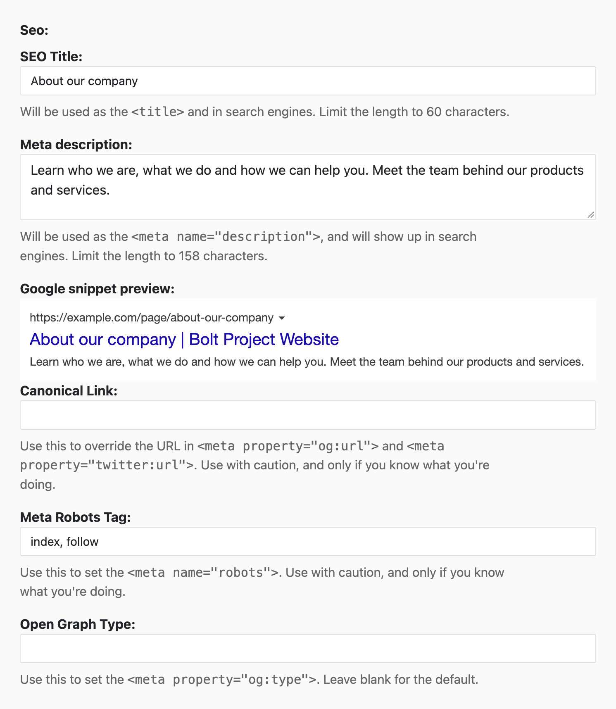

Bolt SEO extension
==================

The Bolt SEO extension is an extension to help you improve the search engine
indexing of your Bolt website in a number of ways. It does this by:

  - Allowing you to specify the SEO title, meta description and (optionally)
    meta keywords for your records, with a Google snippet preview in the editor.
  - Generating the `<title>`, and the meta, Open Graph and Twitter tags for
    your pages.
  - Setting the `<meta name="robots">` tag and `og:type` per record.
  - Overriding the URL used in `og:url` and `twitter:url`, if you really want to.
  - Setting defaults per route or content type listing, optionally per locale.

## Compatibility

This extension supports different Bolt CMS versions depending on the major release:

- **Bolt CMS 6** → Bolt SEO extension **v2.x**
- **Bolt CMS 5** → Bolt SEO extension **v1.x**

This README documents usage for **Bolt CMS 6**.

Installation
-----

```bash
composer require appolodev/bolt-seo
```

Setup
-----

To use this extension, you should add a field to your contenttypes, and add the
tags to the header of your HTML templates.

In your contenttypes, you should add a single `seo` field. The extension will
use this to store the data for the different fields that show in the backend
when editing a record. Simply add it to your fields like this:

```yaml
pages:
    name: Pages
    singular_name: Page
    fields:
        [..]
        seo:
            type: seo
            group: "SEO settings"
```

You can assign the fields their own tab, using the `group: 'SEO settings'`, to
keep them organised in the backend.

After you've done this, it will look like this in the Bolt backend:



To add the SEO title and Meta tags to your HTML, edit your templates (the
'master' or 'header') to have the following:

```HTML
    <title>{{ seo.title() }}</title>
    {{ seo.metatags() }}
```

When you've done this, all pages that make use of these templates will
automatically have the correct `<title>` tag and the meta- and OG-tags.

### Using individual values

Besides `seo.metatags()`, the `seo` object has a method for each value, so you
can output them separately or use them in your own tags:

| Method              | Returns                                                 |
|---------------------|---------------------------------------------------------|
| `seo.title()`       | The page title, as used in `<title>`                    |
| `seo.description()` | The meta description                                    |
| `seo.keywords()`    | The meta keywords                                       |
| `seo.image()`       | The URL of the image for `og:image`, or an empty string |
| `seo.robots()`      | The value for `<meta name="robots">`                    |
| `seo.ogtype()`      | The value for `og:type`                                 |
| `seo.canonical()`   | The URL for `og:url` and `twitter:url`                  |

```twig
<meta name="description" content="{{ seo.description() }}">
<meta property="og:image" content="{{ seo.image() }}">
```

Each value comes from the first of these that is set: the `override_default`
entry for the current route, the record's SEO field, the record's own fields,
and finally the `default` values in `appolo-boltseo.yaml`.

In PHP, for example in your own Twig function, you don't create the `Seo` class
yourself. The same object is available as the `seo` Twig global:

```php
use Appolo\BoltSeo\Seo\Seo;
use Twig\Environment;
use Twig\TwigFunction;

public function getFunctions(): array
{
    return [
        new TwigFunction('my_description', $this->myDescription(...), ['needs_environment' => true]),
    ];
}

public function myDescription(Environment $twig): string
{
    /** @var Seo $seo */
    $seo = $twig->getGlobals()['seo'];

    return $seo->description();
}
```

### Configure the 'meta tags' output

By default, the output of the meta-tags is defined in the file
`vendor/appolodev/bolt-seo/templates/_metatags.html.twig`. If you'd like to
configure this output, you shouldn't edit this file directly. If you do,
changes will be overwritten on subsequent updates of this extension. Instead,
in `/config/extensions/appolo-boltseo.yaml` uncomment the following lines:

```yaml
templates:
    meta: _metatags.html.twig
```

Next, copy the file `_metatags.html.twig` to your theme folder, and the
extension will pick it up from there. The template receives the variables
`title`, `description`, `keywords`, `image`, `robots`, `ogtype` and `canonical`.

### Configuration

The first time the extension runs, Bolt copies its default configuration to
`config/extensions/appolo-boltseo.yaml`. Every option is documented in that
file, including:

  - the title separator and postfix, and the maximum lengths of the fields;
  - which of your content type fields are used as a fallback for the title,
    description and image;
  - the `default` values, used when a record doesn't set its own;
  - `override_default`, to set values per route or content type listing, with
    optional per-locale values.

The meta keywords field in the editor is disabled by default. To enable it, set
`keywords_length` to a value above 0, for example `255`.

Bolt never updates this copy, also not when you update the extension. To see
options added in newer versions, compare your copy with
`vendor/appolodev/bolt-seo/config/config.yaml`.

**Note:** If you'd like to contribute, or have a good idea, feel free to open
an issue on the tracker at the [SEO Extension repository][gh] on GitHub.

[gh]: https://github.com/AppoloDev/bolt-seo/issues

### Contributors

* [Bob den Otter](https://github.com/bobdenotter): Thanks to him to allow me to use his original extension [Bolt SEO](https://github.com/bobdenotter/seo)
